<div align="center">


**Bozorlarni raqamlashtirish platformasi.** Rasta, do'kon va konteynerlar reyestri, ijara shartnomalari, to'lov va kassa, chek, QR orqali to'lov hamda bozorning interaktiv SVG plani bitta tizimda jamlangan.


</div>

---

## Bozor plani muharriri

<div align="center">
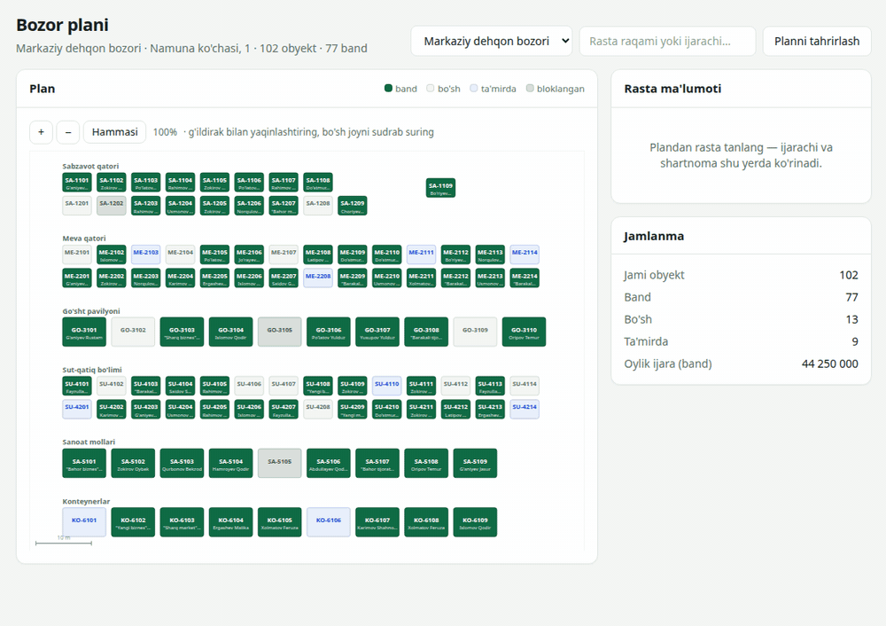
</div>

Bozor plani SVG da chiziladi va har bir rasta haqiqiy o'lchamda turadi (masshtab: 1 m = N px).

1. Rasta bosilganda yon panelda turi, maydoni, oylik narxi, ijarachisi va shartnomasi ochiladi.
2. **Tahrir rejimida** rastani sudrab ko'chirish, pastki o'ng burchagidan tortib o'lchamini o'zgartirish va 90° yoki 15° ga burish mumkin.
3. **«Qator yaratish»** raqam shabloni bo'yicha bir qatorga o'nlab rastani birdan joylaydi. **«Infratuzilma qo'shish»** ijaraga berilmaydigan obyektlarni planga qo'yadi.
4. Ikki obyekt bir joyga tushsa yoki plan chegarasidan chiqsa, server o'zgarishni saqlamaydi.

## Asosiy imkoniyatlar

| | |
|---|---|
| 🏪 **Reyestr** | Do'kon, rasta, konteyner, ombor va pavilyon. Holatlari: bo'sh, band, ta'mirda, bloklangan. Bloklar, maydon va huquqiy rejim (bozor balansida yoki mulkdorga tegishli) hisobga olinadi |
| 📄 **Ijara shartnomalari** | Shartnomada oylik to'lov yoziladi, to'langan summa alohida ko'rinadi. Tarif bo'yicha summa faqat **taklif** sifatida chiqadi va tasdiqni inson beradi |
| 💵 **Kassa va smena** | Naqd pul faqat ochiq smenaga qabul qilinadi, shu sababli har bir so'mning javobgari ma'lum bo'ladi. Smena yopilishi, inkassatsiya va farq sababi yoziladi |
| 🧾 **Chek** | Har to'lovga hisob-kitob hujjati beriladi: QR kod, 58 mm termal printerga mos ko'rinish. Hujjat fiskal chek emasligini o'zi yozib qo'yadi |
| 📱 **QR orqali to'lov** | Rasta stikerida QR bor. U to'lov sahifasini ochadi, keyin Click yoki Payme bilan to'lanadi. Har bozor alohida kassaga ulanadi |
| 🗺️ **SVG plan** | Bozor xaritasi holat bo'yicha ranglanadi. Plan muharririda sudrash, o'lcham, burish, qator generatori va masshtab bor |
| 🏷️ **Tariflar** | Ijara (m² bo'yicha), bir kunlik joy haqi va majburiy xizmat haqi uchun alohida tariflar bor. Tariflar versiyalanadi, o'tgan oy hisobi eski stavka bilan qoladi |
| 📷 **Kamera nazorati** | Bozordagi kompyuterda ishlaydigan agent kamera kadrlarini oladi. Saytda chizilgan zonalar bo'yicha band yoki bo'sh joylar belgilanadi |
| 📊 **Analitika** | Oylik va kunlik tushum, to'lov usullari, bandlik foizi, to'lovlar jurnalidan CSV eksport |
| 📲 **Mobil ish o'rni** | «Tezkor» va «Chekchi» ekranlari bozorda yurib ishlaydigan yig'uvchi uchun mo'ljallangan. Ilova PWA sifatida telefonga o'rnatiladi |
| 👥 **Rollar** | Administrator, boshqaruvchi, yig'uvchi va nazoratchi. Foydalanuvchi bozorga biriktiriladi, bir nechta bozor bitta tizimda yuradi |

## Ekranlar

<table>
<tr>
<td width="50%">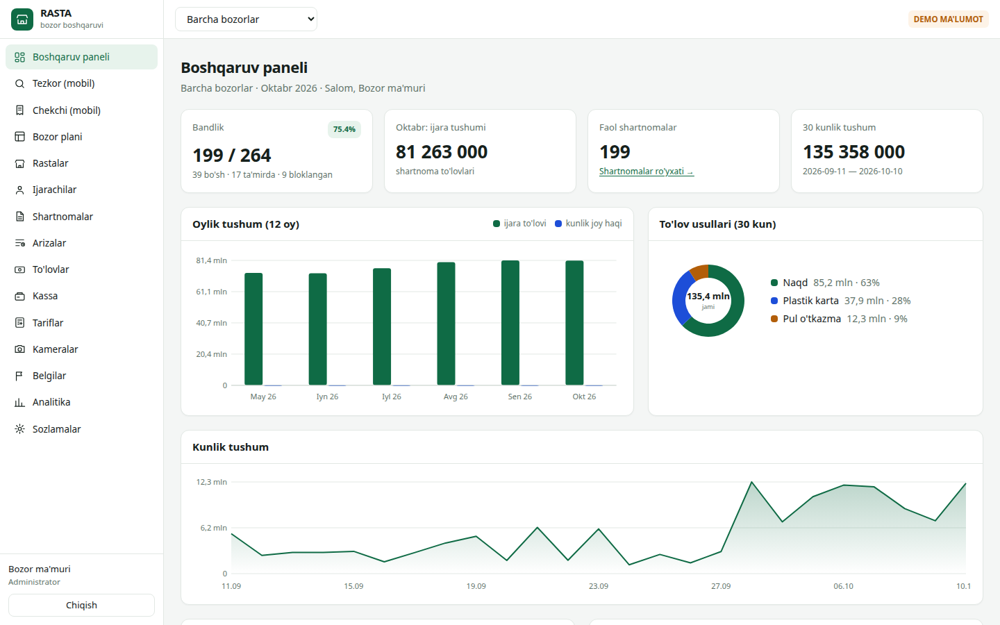<br/><sub><b>Boshqaruv paneli</b>: bandlik, oylik ijara tushumi, to'lov usullari va kunlik tushum</sub></td>
<td width="50%">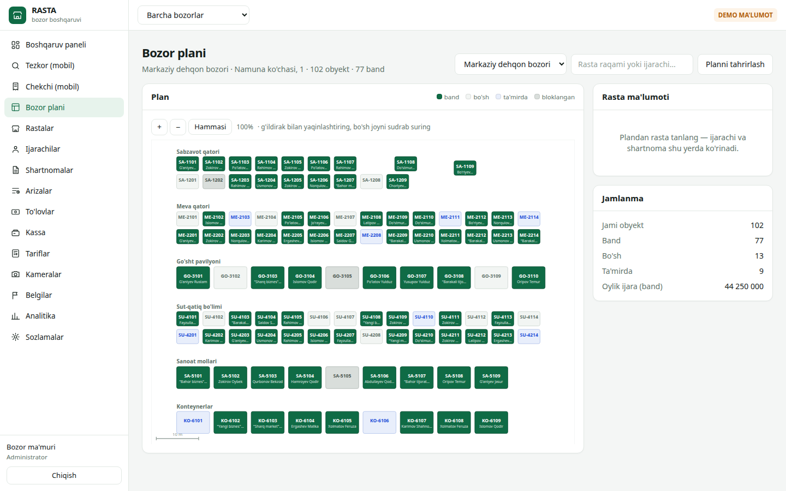<br/><sub><b>Bozor plani</b>: rastalar holati bo'yicha ranglangan, yon panelda jamlanma</sub></td>
</tr>
<tr>
<td>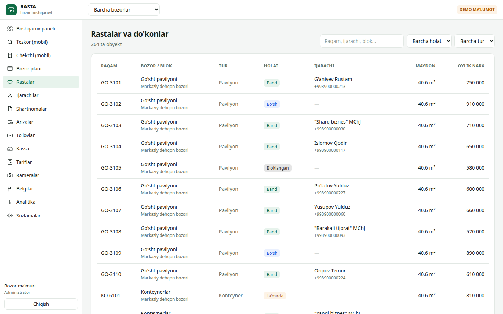<br/><sub><b>Rastalar va do'konlar</b>: blok, tur, holat, ijarachi, maydon va oylik narx</sub></td>
<td>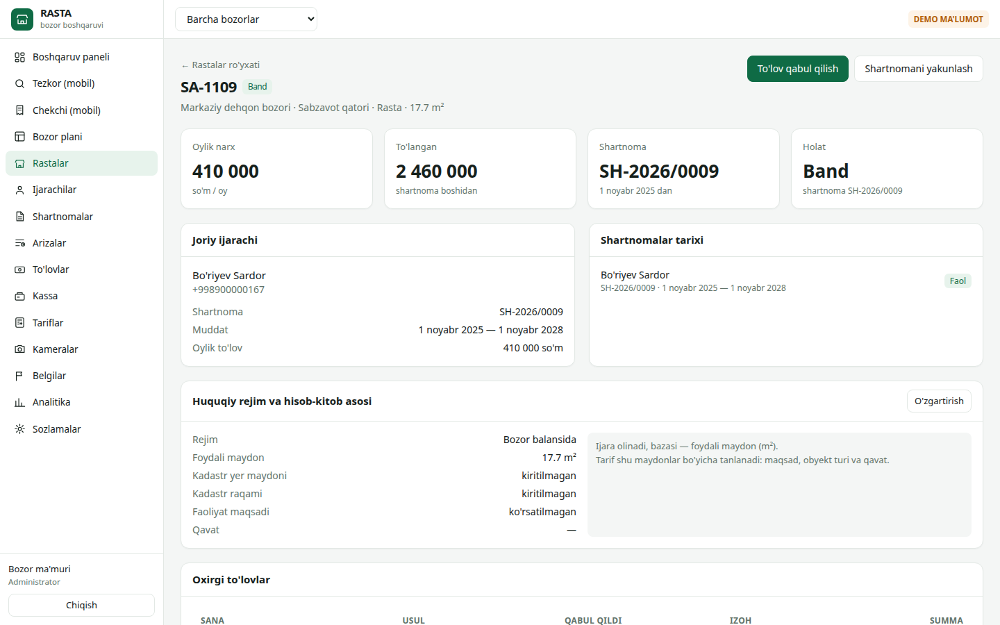<br/><sub><b>Rasta sahifasi</b>: joriy ijarachi, shartnomalar tarixi va huquqiy rejim</sub></td>
</tr>
<tr>
<td>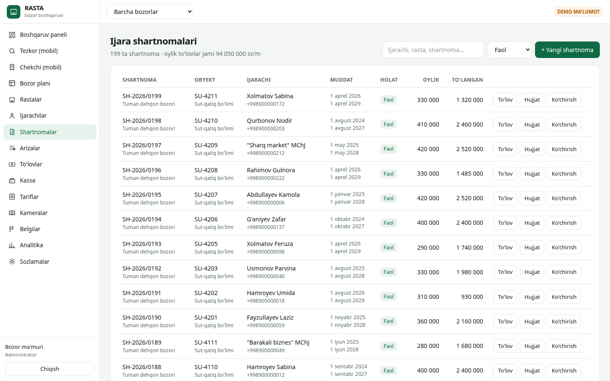<br/><sub><b>Ijara shartnomalari</b>: muddat, oylik to'lov va to'langan summa</sub></td>
<td>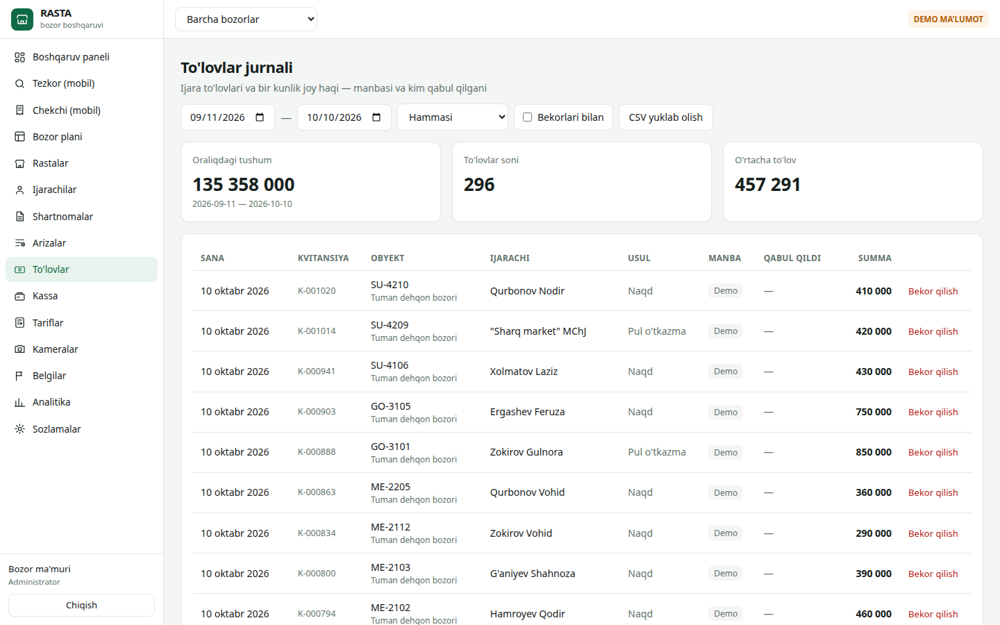<br/><sub><b>To'lovlar jurnali</b>: manbasi va kim qabul qilgani bilan</sub></td>
</tr>
<tr>
<td>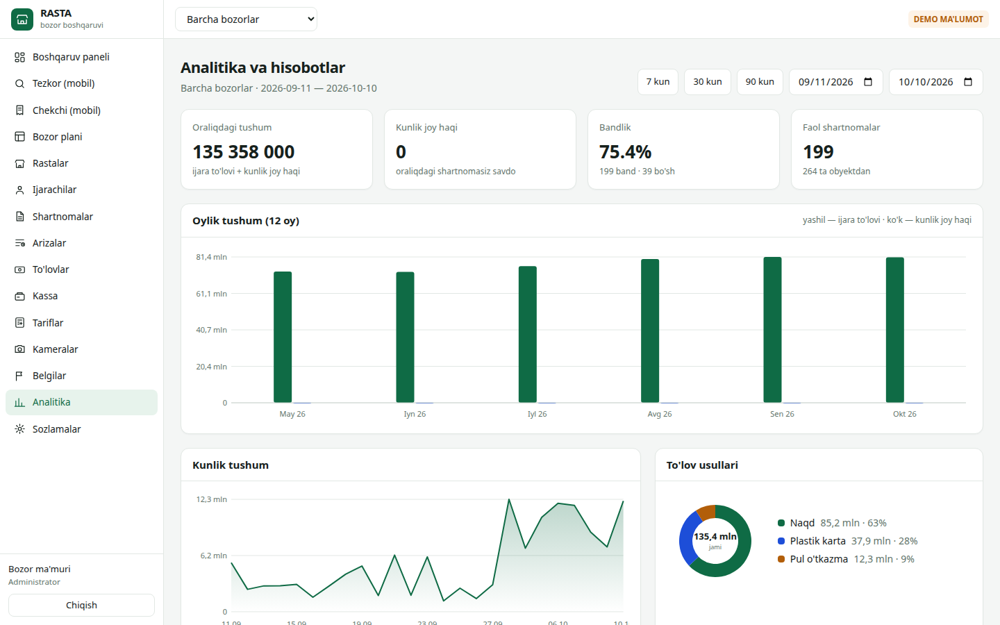<br/><sub><b>Analitika</b>: davr bo'yicha tushum, bandlik va to'lov usullari</sub></td>
<td>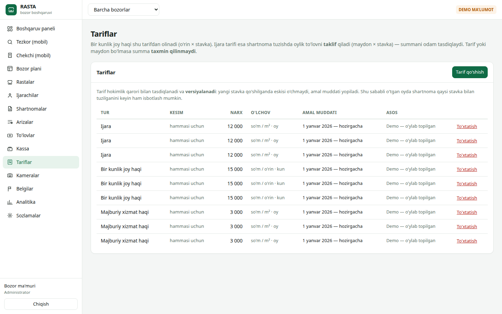<br/><sub><b>Tariflar</b>: ijara, kunlik joy haqi va xizmat haqi stavkalari</sub></td>
</tr>
<tr>
<td colspan="2">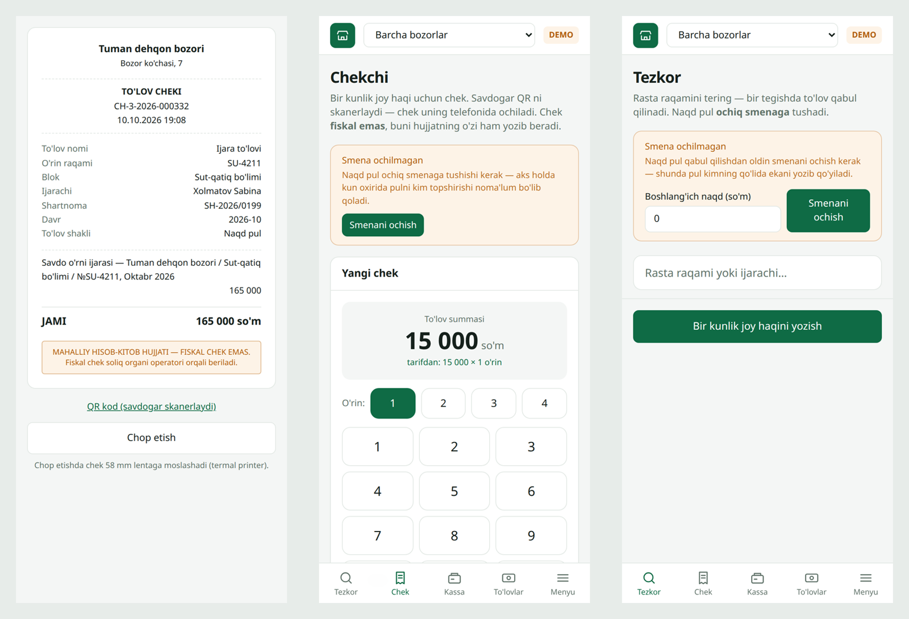<br/><sub><b>Telefonda</b>: chek (QR va termal printer uchun), «Chekchi» raqam klaviaturasi, «Tezkor» ekrani</sub></td>
</tr>
</table>

> Suratlardagi bozorlar, ijarachilar, telefonlar va summalar **namuna (demo) ma'lumot**.

## Arxitektura

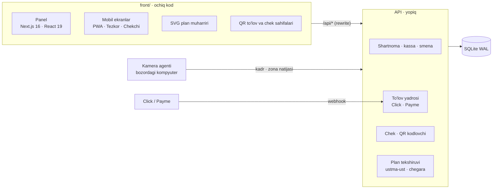

- **Front** Python API ga Next.js rewrite orqali ulanadi, shuning uchun CORS kerak emas va sessiya cookie'si bitta manbada qoladi.
- **API** Python standart kutubxonasida yozilgan, tashqi paket talab qilmaydi. To'lov yadrosi to'rt amaldan iborat (tekshirish, band qilish, bajarish, bekor qilish), Click va Payme shu amallarga tarjima qilinadi. Idempotentlik `UNIQUE(provayder, tashqi_id)` bilan ta'minlanadi.
- **O'rnatish:** Docker yoki systemd xizmatlari, nginx ortida.

## Repoda nima bor

| Papka | Holati |
|---|---|
| `front/` | **Ochiq.** Panel, mobil ekranlar, SVG plan muharriri, UI komponentlari (`komponent/`), API mijozi va turlar (`lib/`) |
| API, to'lov va ijara hisob mantiqi, baza sxemasi, kamera agenti | **Yopiq** |

**Yadro va litsenziya moduli yopiq.** Front alohida yig'iladi:

```bash
cd front
cp .env.example .env.local     # RASTA_API — API manzili
npm install
npm run dev                    # http://localhost:3010
```

## Sifat

- `unittest` — **466 ta sinov** (16 tasi o'tkazib yuborilgan: ular aniqlash modeli fayli bo'lganda ishlaydi). Ular to'lov xavfsizligi, kassa va smena, chek, plan geometriyasi, tariflar, API huquqlari va audit regressiyalarini qamraydi.
- `tsc --noEmit` — front TypeScript xatosiz.

## Texnologiyalar

Next.js 16 · React 19 · TypeScript · Tailwind CSS v4 · Python 3 (stdlib) · SQLite WAL · QR (stdlib kodlovchi) · Click / Payme · Docker

## Jonli

🌐 [elektronbozor.uz](https://elektronbozor.uz)

---

<div align="center">

Namoyish yoki hamkorlik bo'yicha: Telegram [@Humoyun_Davronov](https://t.me/Humoyun_Davronov)

<sub>Muallif — Humoyun Davronov</sub>

</div>
